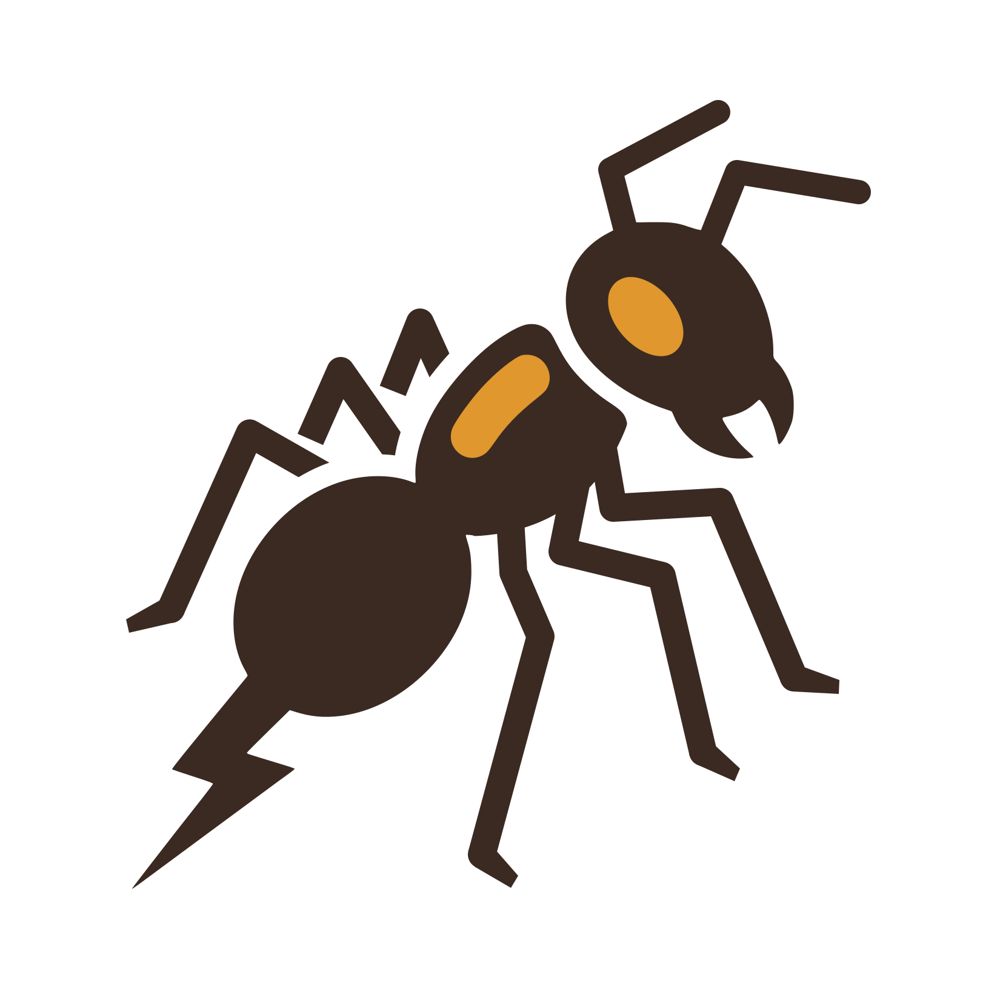

# tocandira

<picture><source media="(prefers-color-scheme: dark)" srcset="docs/logo/tocandira-dark.svg"></picture>
Hive engine: nokamute's search with a learned evaluation (named after the bullet ant; in
Hive the ant is the piece that goes anywhere). Fork of
[nokamute](https://github.com/edre/nokamute) by Eric Roshan Eisner (MIT).
Target: beat nokamute 1.0.3 at equal time per move. Status (2026-10-20): done, 97.7%
[96.4, 98.5] (+650 Elo) over 800 games at 1 s per move, nokamute's search (with the search
options in [docs/pipeline.md](docs/pipeline.md)) with the tocandira evaluation vs nokamute
1.0.3; see [docs/benchmarks.md](docs/benchmarks.md).

## Roadmap

1. **Learned evaluation inside nokamute's search.** Label positions with the engine's own
   search, train a small net, put it back in place of `eval.rs`. Does it beat the hand
   tuned evaluation at equal time per move? Nobody had shown a neural Hive engine that does.
2. If 1 works: **own search**, tuned for the learned evaluation (grows from the vendored `minimax`).
3. If needed: **own board representation**, when incremental net updates ask for it.

Until step 2, every claim reads "nokamute's search with the tocandira evaluation vs
nokamute"; speed and move generation are nokamute's, not ours.

## Layout

- `engine/nokamute/`: the engine fork (submodule, branch `tocandira`): the `search` UHP
  command ([edre/nokamute#13](https://github.com/edre/nokamute/pull/13)), `--nnue`, and a
  vendored `minimax` whose root move order is seeded by the position (deterministic search).
- `tocandira/`: Python lab (numpy is the only runtime dependency).
  - `hive-tournament`: engine vs engine matches over UHP, parallel games, paired random
    openings with colours swapped, Wilson interval, Elo, optional SPRT early stop.
  - `hive-label`: self play, and relabeling of positions (search scores, scalars): the data.
  - `hive-encode`: turns a labels file into NNUE style sparse features (npz).
- `scripts/build_reference.sh`: builds the frozen opponent, upstream `v1.0.3`, into
  `reference/nokamute-1.0.3`. Never taken from the fork.
- `tocandira/nnue.py`: the evaluation net and its training loop (torch, `uv sync --group train`).
- `colab/`: two copies per round, one per Colab session: `01_generate_instance{0,1}`
  (self play), `01_relabel_instance{0,1}` (depths 3-5), `02_train_{a,b}` (a sweep each),
  `03_match_{a,b}` (match lists against the fork and the 1.0.3 reference).
- `docs/`: dated [benchmarks](docs/benchmarks.md), [encoding](docs/encoding.md) design,
  [pipeline](docs/pipeline.md) (how a round goes), `logo/`.
- `runs/`: match records and datasets (gitignored).

## Setup

```bash
git submodule update --init
(cd engine/nokamute && CARGO_PROFILE_RELEASE_LTO=true CARGO_PROFILE_RELEASE_CODEGEN_UNITS=1 cargo build --release)
scripts/build_reference.sh
uv sync
```

## Use

```bash
uv run hive-tournament --a depth=4 --b depth=4,Aggression=5 --games 200   # development, fixed depth
uv run hive-tournament --a seconds=1 --b cmd=ref,seconds=1 --games 400    # the real question
uv run hive-label --games 1000 --depth 4 --random-move-prob 0.1           # -> runs/labels-*.jsonl
uv run hive-label --relabel runs/labels-<stamp>.jsonl --source-depth 4    # + scores at depths 3,4,5
uv run hive-encode runs/labels-<stamp>.jsonl                              # -> runs/labels-<stamp>.npz
```

Player spec: `depth=N` or `seconds=S`; `cmd=/path/to/uhp/engine` or `cmd=ref`; `name=...`;
any other `Key=Value` is sent as a UHP option (`Aggression`, `TableSizeMiB`, ...). All
match numbers are from A's point of view. Fixed depth is for development; the claim that
counts is at equal time, since a learned evaluation costs more per node.

Labels: one JSON object per game: moves and, per position, the root score (side to move's
view), best and played move, outcome; `--relabel` adds a score per depth.
Encoding: one sparse feature per piece relative to the queen, both perspectives, see
[docs/encoding.md](docs/encoding.md).

## Development

```bash
uv run ruff format && uv run ruff check --fix   # format and lint (config in pyproject.toml)
uv run mypy                                     # strict type check of tocandira/
uv run pytest -q                                # engine tests skip until engine/nokamute is built
```

CI runs the same four on every push; conventions in [CONTRIBUTING.md](CONTRIBUTING.md).
